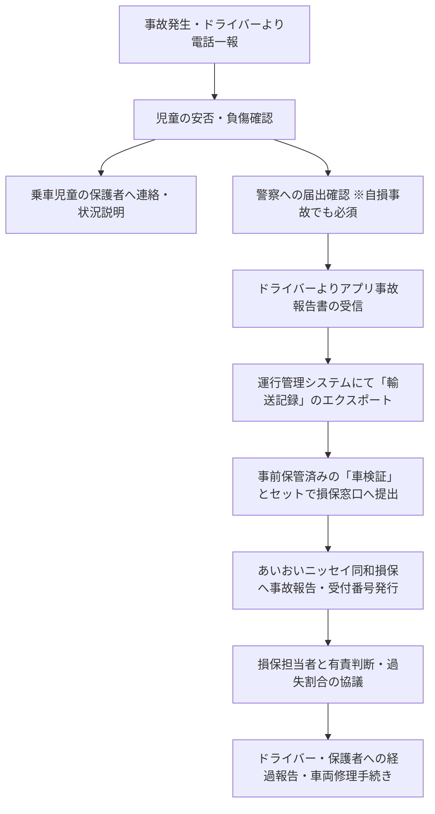

# 【KidsRide 管理者必携】事故対応・損保請求オペレーションマニュアル

**一般社団法人 KidsRide 運行統括本部**  
**取扱代理店: 株式会社 保険あっとなびプラネット東京西（担当: 平 恭子 様）**  
**引受保険会社: あいおいニッセイ同和損害保険株式会社**  
**適用特約: 移動支援サービス事業用自動車保険（優先補償・車両保険なし）特約**

---

## 1. 基本方針と役割分担

KidsRideにおける事故対応は、あいおいニッセイ同和損保の特約規定に基づき、**「初動（現場安全確保）＝ドライバー」＋「保険会社窓口・示談交渉・書類提出＝KidsRide本部」の完全分担制** を採用します。

> **【最重要規則（保険会社規定）】**  
> **登録ドライバーが直接あいおいニッセイ同和損保へ事故報告することは禁止されています。**  
> すべてKidsRide管理者が窓口となり、損保側とのやり取りを行います。

| 担当区分 | 担当者 | 主な責務・役割 |
| :--- | :--- | :--- |
| **現場・初動** | 送迎ドライバー | 負傷者救護、110番警察通報、相手方情報控、現場写真撮影、KidsRide本部への一報、アプリ事故報告フォーム送信 |
| **統括・保険対応** | KidsRide 管理者 | 保護者への説明・ケア、輸送記録（運行ログ）突合、車検証・事故報告書準備、あいおいニッセイ同和損保窓口、過失割合・保険使用判断 |

---

## 2. 事故発生時の時系列オペレーションフロー

### [フェーズ 1] ドライバーからの電話一報時（受電直後）
1. **児童の安全確認**: お子様に怪我や精神的ショックがないか最優先で確認。
2. **警察への届出の確認**: 「警察を呼びましたか？」「自損でも必ず呼んでください」と指示。
   * ※警察への届出（110番）さえ完了していれば、担当官名や事故番号が未定でも初期受付可能です（発生場所から保険会社側で管轄警察署を特定可能なため）。
3. **その場での示談禁止の念押し**: 相手方と過失割合や金銭の話をしないよう注意喚起。
4. **ドライバーによる直接損保連絡の抑止**: 「保険会社へは本部から連絡するので、相手方にはKidsRide本部と保険会社を通じて対応すると伝えてください」と指示。
5. **現場写真の撮影指示**: 車両損傷箇所、事故現場全体の撮影を依頼。

### [フェーズ 2] 保護者への初期連絡
1. 事故の事実、お子様の怪我の有無、現在の所在地を冷静に伝える。
2. 必要に応じて管理者が現場へ急行、または代行送迎手段を手配。

### [フェーズ 3] あいおいニッセイ同和損保への事故報告・書類提出
ドライバーからアプリで「事故報告」が届いたら、直ちに損保窓口へ一括送付します。

#### 【保険会社提出 必須書類セット】（※KidsRide自社システム帳票提出合意済）
1. **事故報告書**（ドライバー提出内容の要約）
   * 事故車両情報（登録番号、車種、所有者）
   * 運転者情報（氏名、免許番号等）
   * 事故発生日時・正確な場所
   * 損傷箇所（写真添付）
   * 詳細な事故状況・原因
   * 相手方情報（氏名、連絡先、車両、相手保険会社）
   * 警察届出情報（警察署名・担当官名・事故受理番号 ※判明次第追加）
2. **輸送記録（KidsRide運行日報・ログ）**
   * ドライバー名
   * 出発地・出発時刻
   * 帰庫（到着）予定・時刻
   * 利用者（児童）の乗降場所・時刻
   * 実走行距離
   * **「移動支援サービス運行中であること」が証明できるアプリ画面出力 / PDF**
3. **事故車両の自動車検査証（車検証）**
   * ドライバー登録審査時にデータベースに保管されている画像データを出力・提出。

---

## 3. 保険特約の内容および注意事項

### ① 補償内容
* **対人賠償保険**: 無制限（対歩行者等傷害特約付）
* **対物賠償保険**: 無制限（免責金額なし・対物超過修理費用特約50万円限度付）
* **人身傷害保険**: 1名につき 3,000万円（同乗児童およびドライバー自身の死傷）
* **ロードサービス費用特約**: 運搬・搬送・引取費用（※代車補償対象外特約）

### ② 免責事項・対象外（要注意）
* **車両保険なし**: ドライバー自身の車の修理費は補償されません。
* **代車補償なし**: 事故時の代車費用は出ません。
* **個人保険の継続義務**: 運行時以外は補償されないため、ドライバー自身の自動車保険（任意保険）の継続加入が必須です。

### ③ 補償対象自動車の所有要件
KidsRideが事前に承認した自動車で、以下のいずれかが所有するものに限られます：
1. 登録ドライバー本人
2. 登録ドライバーの配偶者
3. 登録ドライバーまたはその配偶者の父母または子
4. 登録ドライバーまたはその配偶者の同居の親族
5. 1〜4のいずれかに該当する者が役員となっている法人
6. 1〜5以外の者で、移動支援サービスのためにKidsRideに貸し渡す者

### ④ 補償対象区間（合理的な経路）
* 自宅等を出発 〜 自宅等への帰着（待機を含む）。
* **合理的な経路を著しく逸脱した私用・寄り道中の事故は対象外**となります。

---

## 4. 保険料体系および月次実績報告（満期精算）

* **保険料計算式**: `90円 × 運行時間 × 日数`
* **暫定保険料（契約時）**: `34,020円`（90円 × 1時間 × 378日 / 42日 × 9台）
* **月次通知義務**:
  * 毎月、稼働実績（出発地・目的地、輸送開始・終了日時）を取りまとめ、所定のシートにてあいおいニッセイ同和損保（平様）へ報告。
  * **※実績が0日の月であっても通知が必須です。**
* **満期精算**: 契約満期時に、毎月の実績報告に基づき確定保険料を精算。

---

## 5. 窓口連絡先一覧

* **取扱代理店**:
  * 株式会社 保険あっとなびプラネット東京西
  * 担当: **平 恭子 様**
  * TEL: `042-481-5203` / Mobile: `070-2251-1896`
  * Fax: `042-484-9510`
  * Email: `k-taira.hoken@navipranet.com`
* **引受保険会社**:
  * あいおいニッセイ同和損害保険株式会社
* **KidsRide 運行統括本部**:
  * 代表理事: 七夕 光基
  * TEL: `070-2251-1896` / `090-8848-0707`
